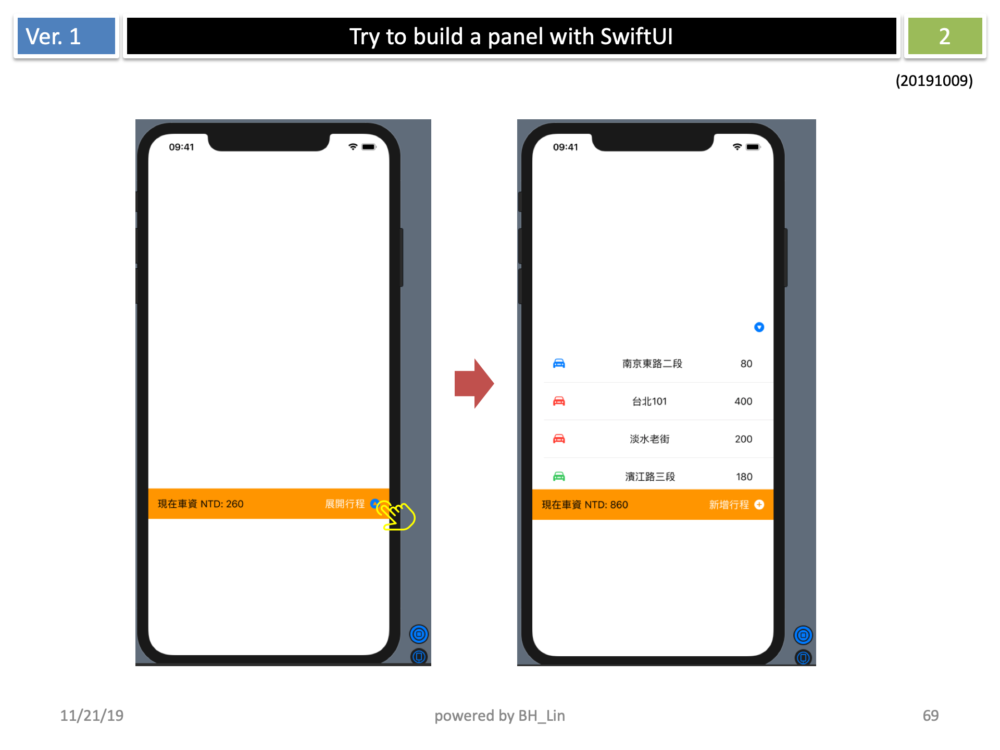

# Simple Panel with SwiftUI

A SwiftUI demo application showcasing an expandable/collapsible panel interface for managing routing stops in a ride-sharing or taxi service context. This project demonstrates modern SwiftUI patterns including state management, custom animations, and MVVM architecture.



## Demo


## Features

- **Expandable Panel Interface**: Toggle between collapsed and expanded states
- **Dynamic Route Management**: Add up to 4 stops total (pickup, destination, + 2 intermediate stops)
- **Smart Deletion Protection**: Prevents deletion of pickup location and destination
- **Real-time Price Calculation**: Automatically calculates and displays total trip cost
- **Visual Stop Classification**: Color-coded icons for different stop types
  - 🔵 Blue: Pickup location (Type 1)
  - 🟢 Green: Destination (Type 2) 
  - 🔴 Red: Intermediate stops (Type 3)
- **Swipe-to-Delete**: Intuitive gesture-based stop removal
- **Alert System**: User-friendly warnings for invalid operations

## Requirements

- iOS 13.0+
- Xcode 11.0+
- Swift 5.1+

## Installation

1. Clone this repository:
   ```bash
   git clone https://github.com/yourusername/simple_panel_with_SwiftUI.git
   ```

2. Open `mySample.xcodeproj` in Xcode

3. Build and run the project on your preferred iOS simulator or device

## Project Structure

```
mySample/
├── ContentView.swift           # Main UI view with panel logic
├── Models/
│   ├── RoutingPath.swift      # Data model for individual stops
│   ├── RoutingViewModel.swift # ObservableObject for state management
│   ├── data.swift            # Data loading utilities
│   └── RoutingViewData.swift # Additional view data structures
├── Resources/
│   └── data.json             # Initial routing data
├── RoutingPathRow.swift      # Custom row component for stops
└── ...                       # Standard iOS app files
```

## Architecture

This project follows the **MVVM (Model-View-ViewModel)** pattern:

- **Model**: `RoutingPath` struct defines the data structure for routing stops
- **View**: `ContentView` and `RoutingPathRow` handle the UI presentation
- **ViewModel**: `RoutingViewModel` manages application state using `@Published` properties

### Key SwiftUI Concepts Demonstrated

- `@EnvironmentObject` for dependency injection
- `@Published` properties for reactive data binding
- Custom view components and reusability
- Conditional view rendering with dynamic layouts
- List management with `ForEach` and `.onDelete`
- Alert presentation and user interaction handling

## Usage

1. **Expand Panel**: Tap "展開行程" (Expand Route) to show current stops
2. **Add Stops**: When expanded, tap "新增行程" (Add Stop) to insert intermediate destinations
3. **Remove Stops**: Swipe left on intermediate stops to delete them
4. **View Cost**: Total trip cost is displayed at the bottom in NTD (New Taiwan Dollars)
5. **Collapse Panel**: Use the arrow button to minimize the panel

## Technical Highlights

- **Reactive UI**: Automatic updates when data changes using SwiftUI's binding system
- **Custom Animations**: Smooth expand/collapse transitions with dynamic height calculations
- **Data Persistence**: JSON-based data loading with error handling
- **Type Safety**: Strongly-typed models with `Codable` support
- **Preview Support**: SwiftUI previews for rapid development iteration
